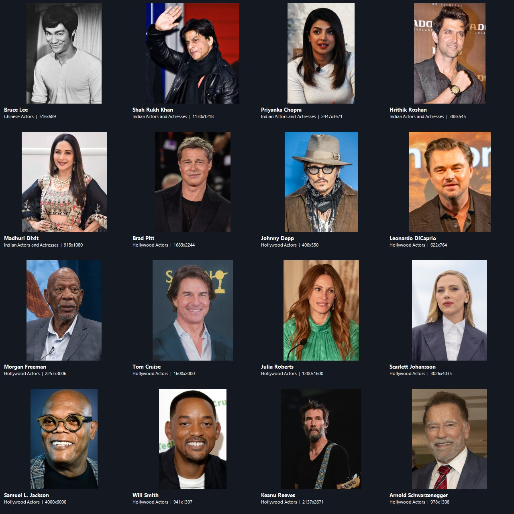

# Character library production evidence — 2026-10-19

This sheet contains the actual pixels of 16 newly acquired and visually
reviewed actor photos. It is a review artifact, not a gameplay screenshot.

The source page, license, and attribution for each file are recorded in
`assets/brand/character_pictures/CREDITS.md`; dimensions and SHA-256 values are
in the adjacent character-picture manifest. The focused Flutter test verifies
that all approved bundled images decode and form playable picture challenges.

Fourteen of the 16 photos pass the existing bundled dimension gate and are
playable: Bruce Lee, three Indian actors, and ten Hollywood actors. Hrithik
Roshan and Johnny Depp are retained as reviewed candidates but excluded because
their dimensions fall below that gate. The accepted content brings playable
counts to Chinese 5, Indian 19, Hollywood 20 (44 total). This adds no
fictional-character images. Wikimedia
Commons rate-limited the run with HTTP 429; two attempted Indian actor assets
were not acquired. No unverified candidates or URLs are counted.
