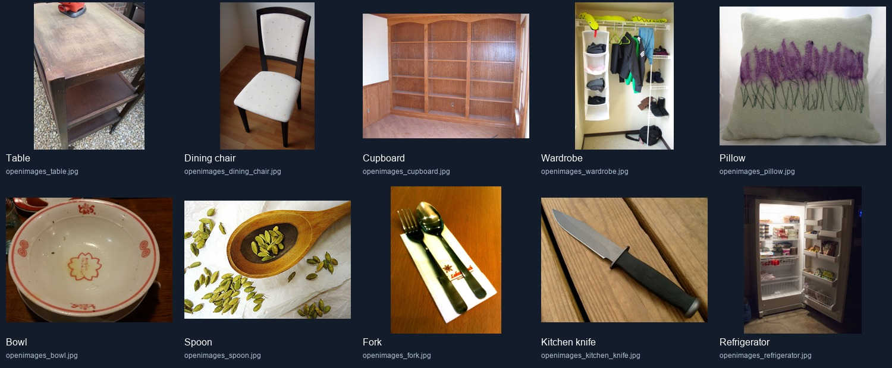
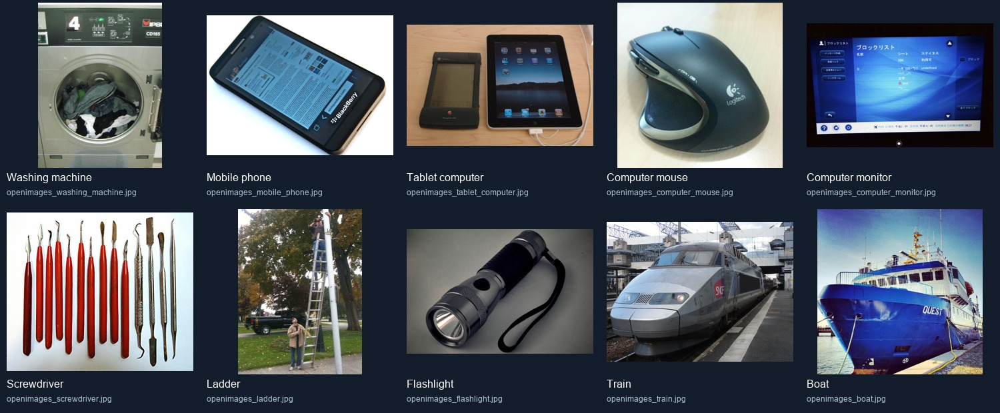
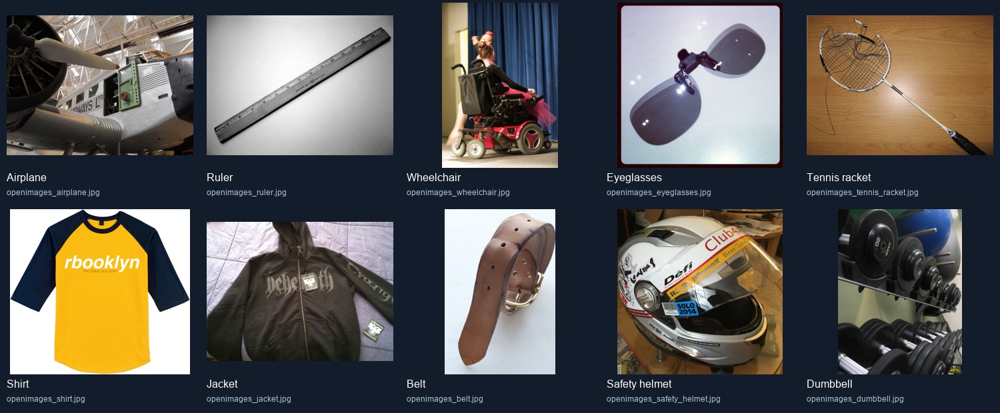
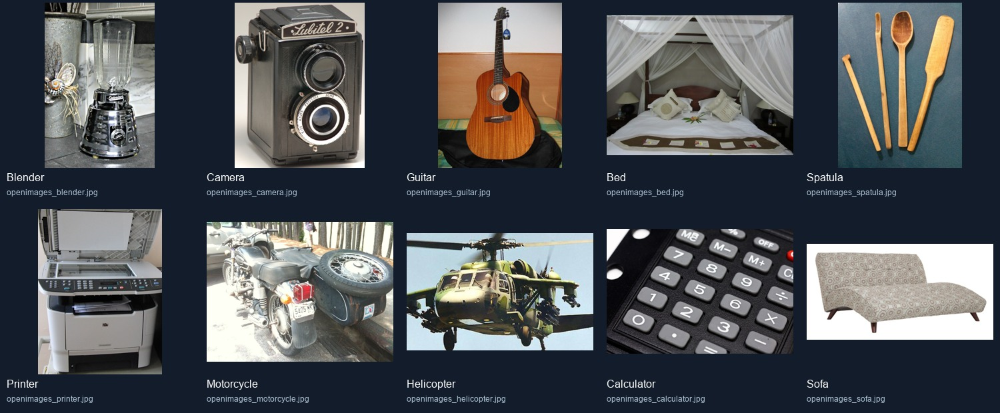
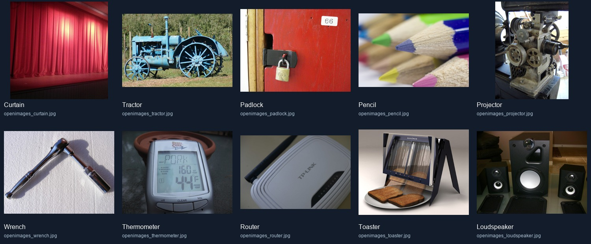

# Open Images object-media batch - 18 October 2026

## Result

- Existing object identities with newly bundled playable images: 50.
- Existing object-picture images before this batch: 28.
- Bundled offline image-backed challenges after this batch: 78 of the existing 100 object records.
- Remaining existing object records without a bundled picture: 22.
- New object identities added: 0.
- Total size of the 50 new optimized JPEG files: 9,349,498 bytes.
- Accepted photographs are 50 distinct Open Images image IDs; duplicate IDs and SHA-256 hashes were checked.
- New files preserve source aspect ratio, are not upscaled or cropped, and decode at more than 500 x 300 pixels.

## Acquisition and review

Candidates were selected from Open Images validation metadata and box annotations where available, downloaded individually from the official Open Images image host, decoded, and visually reviewed in the contact sheets below. Some top-up candidates for categories with no suitable surviving box candidate were found by exact source-metadata titles and separately confirmed visually; those records retain their actual annotation labels (or an empty list) rather than asserting false annotations. No candidate is counted on label or title alone.

The per-image manifest records the original landing page, metadata creator and title, image ID, annotation labels when present, CC BY license URL, modified-file description, dimensions, and SHA-256. Each image is bundled locally; the game does not need a network connection to display these challenges.

Each source image is individually recorded as CC BY 2.0. This is not an assertion that Open Images annotations license the photos. The source image license is checked per image; these files were re-encoded without cropping, and attribution is included in assets/app/objects/CREDITS.md.

## Review contact sheets

## Source notes

- Open Images V7 official download page and subset instructions: https://storage.googleapis.com/openimages/web/download_v7.html
- Its manual instructions support filtering annotations to IDs and downloading only selected images rather than the full image corpus. The download page links to validation image metadata and bounding-box CSV for this split.
- Open Images metadata includes the original source URL, creator, title, and individual image license.
- Dataset annotations are discovery and selection metadata, not a grant of underlying image copyright.

This batch covers object content only. No actor portraits or fictional-character images were added in this batch.

## Runtime and build verification

- `flutter analyze`: passed with no issues.
- Full `flutter test`: 136 passed, including decoding all 78 bundled object images, manifest-to-catalog identity matching, and category filtering.
- Android debug APK: built successfully after a failed first attempt hit Java's loopback connection error. The owner-approved `JAVA_TOOL_OPTIONS=-Djdk.net.unixdomain.tmpdir=C:\Windows\Temp` workaround was applied only to the build process and removed afterward.
- Android runtime: the APK was installed with `adb install -r` over the existing `com.example.roundveil` installation. On `Medium_Phone_API_37.0` (API 37, x86_64), an Object Picture match reached the clue-giver reveal screen and displayed a newly bundled tablet-computer photograph after turn-away confirmation. The app process remained alive. See `android_object_revealed.png`.
- Windows debug build: compilation passed. Windows runtime was not tested in this batch; Enterprise Application Control remains a separate known launch restriction.
- Offline verification: files are packaged in the app bundle and all 78 catalog images decoded in tests. The emulator's network was not explicitly disabled during the runtime screenshot.
