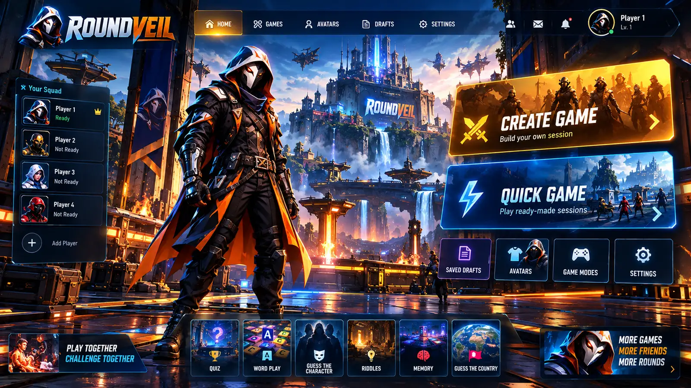
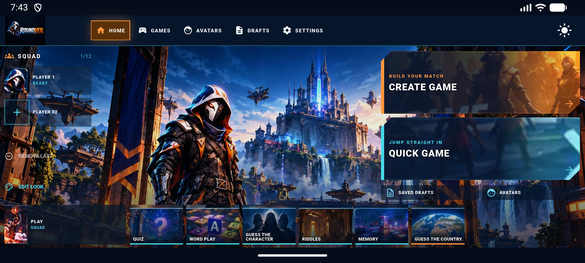

# Version 5 home reconstruction candidate

This is a live Flutter implementation under review, not an approved interface.

The left image is the supplied approved Version 5 reference; the right image is a real capture from `Medium_Phone_API_37.0` in landscape after adding Player 1. The app uses live Flutter controls and the full reference screenshot is not used as a rendered interface.

| Approved Version 5 reference | Android runtime capture |
| --- | --- |
|  |  |

## Asset treatment

- `assets/brand/approved_home_v5_scene_source.webp` is a flattened screenshot, not a layered source file.
- `assets/brand/v5/v5_arena_scene_reconstruction.jpg` is a generated arena/hero scene plate based on the supplied V5 composition. It is not an original export or pixel-exact recreation.
- Squad portraits, game-mode art, the lower Play Together thumbnail, and card scene crops are drawn from the supplied V5 screenshot and composed behind live text and Flutter hit targets.
- The six game tiles navigate to the existing game library; Create Game, Quick Game, Drafts, Avatars, player add/remove and Edit Look connect to current app destinations/actions.

## Verification

- `flutter pub get`: passed.
- `flutter analyze`: passed, no issues.
- `flutter test`: passed, 31 tests.
- `flutter build apk --debug`: passed.
- Install and launch: passed on `Medium_Phone_API_37.0` (`emulator-5554`, x86_64); Player 1 add interaction rendered the supplied portrait. No fatal startup exception or `RenderFlex overflow` was found in the captured log window.
- Windows rendering was not verified in this slice; the existing `flutter_windows.dll` launch failure is recorded in `PROJECT_STATUS.md` and was kept separate from Android development.

Review the runtime against the reference before any approval status changes. Visible differences include Android system bars, responsive scaling/cropping, simplified top-right profile/social controls, and generated rather than original layered arena artwork.
